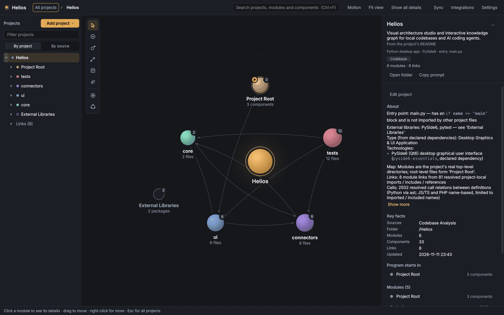

# Helios

Helios is a desktop app that turns your local code projects and your AI coding sessions into an interactive map of how each project is built.



## What it does

- **Maps a codebase.** Point Helios at a folder and it draws the project's modules and the links between them. Links come only from imports it really found in the code (Python, JavaScript/TypeScript, PHP and HTML). Nothing is guessed.
- **Imports your AI coding history.** Helios can read the local session logs of Antigravity, OpenAI Codex and Claude Code, find the project folders you worked in, and map the real code in each one. Your sessions are listed in a separate "Work History" module.
- **Shows what each project is for.** Above the map you see a short purpose line, taken from the project's own description (for example the README). Below it is a "what it is" line built from the code analysis, such as `Python desktop app · PySide6 · entry: main.py`. You can always write your own purpose.
- **Optional local AI (Ollama).** If you have Ollama, it can write short descriptions and suggest a purpose. A suggestion is only a suggestion: you can accept, edit or dismiss it. The AI only writes text; it never adds or removes anything on the map.
- **Lets you draw and edit.** Add modules, components, links and notes on the canvas. Undo and redo work with `Ctrl+Z` / `Ctrl+Y`.
- **Copies a ready prompt.** "Copy prompt" turns a project's overview, modules and links into text you can paste into a coding agent.

## Getting started

You need Python 3.10 or newer.

```bash
pip install -r requirements.txt
python main.py
```

On Windows you can also double-click `run_helios.bat`.

Helios runs from this folder; it is not installed as a package. To map your own repositories, put them in the `projects/` folder and scan it from the app, or add any folder from inside the app.

## Optional: Ollama

Helios works fully without AI. If [Ollama](https://ollama.com) and a model are installed on your computer, Helios finds them on its own. You can pick the model or turn Ollama off in Settings.

## Your data

Everything stays on your computer. Your projects are saved in the `data/` folder (`data/galaxy.json`), which is git-ignored, so it is never committed. Helios reads AI session logs only from your own machine.

## For developers

```bash
pip install -r requirements-dev.txt
QT_QPA_PLATFORM=offscreen python -m pytest tests -q
```

On Windows PowerShell, run `$env:QT_QPA_PLATFORM = "offscreen"` first. Tests never write to the repo's `data/` folder.

See [CLAUDE.md](CLAUDE.md) for the architecture, coding rules and the live CLI bridge (`python -m connectors.live_bridge`), which lets coding agents update a running Helios app.

## Known limitations

- Dependency links are drawn only for Python, JavaScript/TypeScript, PHP and HTML. Other languages get modules and components but no links.
- The Antigravity, Codex and Claude Code importers read local file formats that those tools may change at any time.

## License

MIT. See [LICENSE](LICENSE).
