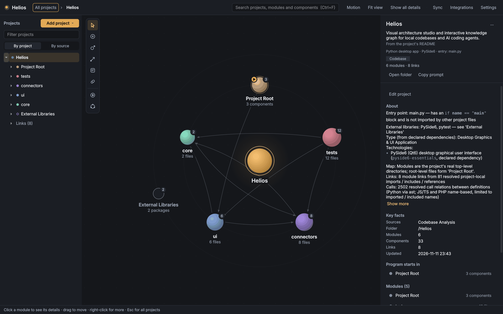

# Helios

Helios is a desktop app that turns your local code projects and your AI coding sessions into an interactive map of how each project is built.



## What it does

- **Maps a codebase.** Point Helios at a folder and it draws the project's modules and the links between them. Links come only from imports it really found in the code (Python, JavaScript/TypeScript, PHP and HTML). Nothing is guessed.
- **Imports your AI coding history.** Helios can read the local session logs of Antigravity, OpenAI Codex and Claude Code, find the project folders you worked in, and map the real code in each one. Your sessions are listed in a separate "Work History" module.
- **Shows what each project is for.** Above the map you see a short purpose line, taken from the project's own description (for example the README). Below it is a "what it is" line built from the code analysis, such as `Python desktop app · PySide6 · entry: main.py`. You can always write your own purpose.
- **Optional local AI (Ollama).** If you have Ollama, it can write short descriptions and suggest a purpose. A suggestion is only a suggestion: you can accept, edit or dismiss it. Suggestions are only shown while Ollama is available, and only while the project has not changed since the suggestion was made. The AI only writes text; it never adds or removes anything on the map.
- **Lets you draw and edit.** Add modules, components, links and notes on the canvas. Undo and redo work with `Ctrl+Z` / `Ctrl+Y`.
- **Copies a ready prompt.** "Copy prompt" turns a project's overview, modules and links into text you can paste into a coding agent.
- **Finds things fast.** Type in the search box (`Ctrl+F`) to find projects, modules, components, functions, classes, files and libraries. Use Up / Down and Enter to jump to a result, Esc to close the list.
- **Filters the map.** In an open project, **Filter** lets you hide some kinds of links, the external libraries, the Work History or whole layers. It only changes what you see, never your project. **Show all** brings everything back.
- **Exports the map.** In the project's **…** menu (or with `Ctrl+E`) you can save the map as a PNG image or as a Markdown (`.md`) document that lists the modules, components and links.

## Download and run

You do not need Python for this. Open the [Releases page](https://github.com/OYGUS/Helios/releases) and download the file for your system from the newest release. Helios is not signed, so each system warns you the first time you open it.

### Windows

1. Download `Helios-windows.zip`.
2. Unzip it (right-click → **Extract All**).
3. Open the `Helios` folder and double-click `Helios.exe`. Keep the other files in that folder next to it.

If Windows SmartScreen says "Windows protected your PC", click **More info**, then **Run anyway**.

### macOS

For now there is only a build for Apple Silicon Macs (M1 and newer) with macOS 14 (Sonoma) or newer.

1. Download `Helios-macos.zip` and double-click it to unzip it.
2. Move `Helios.app` to your **Applications** folder.
3. The first time, right-click `Helios.app` and choose **Open**, then **Open** again. On recent macOS versions this may not be offered: try to open the app once, then go to **System Settings → Privacy & Security** and click **Open Anyway** next to the message about Helios.

Instead of step 3 you can also run this once in Terminal:

```bash
xattr -dr com.apple.quarantine /Applications/Helios.app
```

### Linux

There is a build for 64-bit x86 (x86_64) systems with a recent glibc, such as Ubuntu 22.04 or newer.

```bash
tar -xzf Helios-linux.tar.gz
./Helios/Helios
```

Keep the other files in the `Helios` folder next to the `Helios` program. If it does not start on Debian or Ubuntu, install the missing Qt library with `sudo apt install libxcb-cursor0`.

### First start

The app starts with no projects. A welcome panel shows the ways to add your first one: **Analyze a folder…**, the `projects` folder, or importing from your AI coding tools.

## Run from source

You need Python 3.10 or newer. On Python 3.10 and 3.11, PySide6 6.12.0 crashes after a while of use; `requirements.txt` skips that version, so install from it rather than installing PySide6 by hand.

```bash
pip install -r requirements.txt
python main.py
```

On Windows you can also double-click `run_helios.bat`. On macOS and Linux the commands may be `pip3` and `python3`. On Debian or Ubuntu, Qt also needs `sudo apt install libxcb-cursor0`.

Helios runs from this folder; it is not installed as a package. To map your own repositories, put them in the `projects/` folder and scan it from the app, or add any folder from inside the app.

## Optional: Ollama

Helios works fully without AI. If [Ollama](https://ollama.com) and a model are installed on your computer, Helios finds them on its own. You can pick the model or turn Ollama off in Settings.

## Your data

Everything stays on your computer. Helios reads AI session logs only from your own machine.

- **Downloaded app:** your data is in a per-user folder. It holds `data/galaxy.json` (your projects), `data/settings.json` and the `projects/` folder. Deleting or updating the app does not delete your data.
  - Windows: `%APPDATA%\Helios` (paste that into the Explorer address bar).
  - macOS: `~/Library/Application Support/Helios` (in Finder: **Go → Go to Folder…**).
  - Linux: `~/.local/share/Helios` (or `$XDG_DATA_HOME/Helios` if that is set).
- **From source:** your data is in this repository's `data/` folder (`data/galaxy.json`), which is git-ignored, so it is never committed.

To keep your data somewhere else, set the environment variable `HELIOS_DATA_DIR` to a folder; Helios then uses `data/` and `projects/` inside it.

## For developers

```bash
pip install -r requirements-dev.txt
QT_QPA_PLATFORM=offscreen python -m pytest tests -q
```

On Windows PowerShell, run `$env:QT_QPA_PLATFORM = "offscreen"` first. Tests never write to the repo's `data/` folder.

### Build the app

The build recipe for all three systems is `helios.spec` (PyInstaller). Build on the system you build for; each build script creates a build environment in `.venv-build` and installs `requirements-build.txt` (Helios's requirements plus PyInstaller) into it.

- **Windows:** double-click `build_exe.bat` (or run it in a terminal). It writes `dist\Helios\Helios.exe` and `dist\Helios-windows.zip`.
- **macOS:** run `bash build_app.sh`. It writes `dist/Helios.app` and `dist/Helios-macos.zip`.
- **Linux:** run `bash build_app.sh`. It writes `dist/Helios/Helios` and `dist/Helios-linux.tar.gz`. On Debian or Ubuntu, install Qt's libraries first (the list is in `.github/workflows/release.yml`, step "Install Qt system libraries").

To check a build, start it with `--smoke-test`: it opens the window, waits about three seconds and quits with exit code 0.

### Make a release

The version number lives only in `pyproject.toml`. To publish it, push a tag with the same number:

```bash
git tag v0.2.0
git push --tags
```

Before you push the tag, commit the release text as `docs/release-notes/<tag>.md` (for example `docs/release-notes/v0.2.0.md`); the release fails without it.

GitHub Actions (`.github/workflows/release.yml`) then runs the tests and builds Helios on Windows, macOS (Apple Silicon) and Linux, checks that each build starts, and creates one release on the Releases page with `Helios-windows.zip`, `Helios-macos.zip` and `Helios-linux.tar.gz`. You can also start it by hand from the Actions tab; the three files are then only workflow artifacts and no release is made.

See [CLAUDE.md](CLAUDE.md) for the architecture, coding rules and the live CLI bridge (`python -m connectors.live_bridge`), which lets coding agents update a running Helios app.

## Known limitations

- Dependency links are drawn only for Python, JavaScript/TypeScript, PHP and HTML. Other languages get modules and components but no links.
- The Antigravity, Codex and Claude Code importers read local file formats that those tools may change at any time.

## License

MIT. See [LICENSE](LICENSE).
